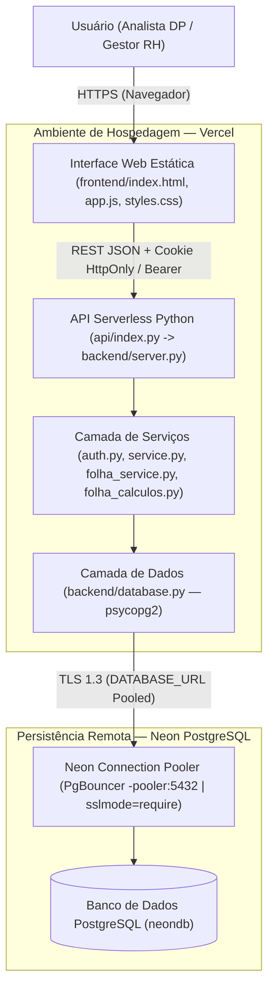

# 02 — Arquitetura e Persistência (Frontend, Backend, Vercel e Neon PostgreSQL)

**Projeto:** RH2.0 — Portal de Departamento Pessoal & Folha de Pagamento  
**Data:** 18/11/2026

---

## 1. Arquitetura Real Investigada e Decisão de Preservação (Seção 3.1)

### 1.1. Como o sistema é executado hoje
- **Desenvolvimento Local:** `python backend/server.py` inicia um servidor HTTP na porta `8000` (`socketserver.TCPServer` com `ApiColaboradorHandler`), servindo simultaneamente os arquivos estáticos de `frontend/` (`index.html`, `styles.css`, `app.js`, `assets/`) e todas as rotas REST sob `/api/*`.
- **Produção / Hospedagem no Vercel:**
  - Os arquivos estáticos de `frontend/` são servidos pela CDN do Vercel (`/(.*)` -> `/frontend/$1`).
  - As rotas `/api/*` são executadas como **Vercel Python Serverless Functions** (runtime `@vercel/python`, que suporta classes `handler(BaseHTTPRequestHandler)` nativamente).
- **Decisão Arquitetural:** O projeto **pode e deve ser executado integralmente no Vercel** (Frontend Estático + API Python Serverless) conectado ao **Neon PostgreSQL**. Não é necessário substituir Python por Node/NestJS nem contratar um servidor persistente separado, pois a aplicação não depende de processos em segundo plano (background jobs de longa duração) nem de estado em memória para suas operações de negócio.

---

## 2. Arquitetura de Referência Homologada (Seção 3.2)

### Garantias Arquiteturais
1. **Zero Exposição no Navegador:** Nenhuma credencial, hostname do Neon ou string de conexão (`DATABASE_URL`) é enviada ao navegador ou exposta em respostas JSON (mesmo em falhas HTTP 503).
2. **Fonte Única da Verdade:** O Neon PostgreSQL armazena usuários, sessões, auditoria, parâmetros/empresa, colaboradores, dependentes, histórico cadastral, folhas de pagamento, itens calculados e histórico de fechamento.
3. **Proibição de Fallback Efêmero em Produção:** Quando `em_producao()` detecta `VERCEL=1`, `VERCEL_ENV` ou `APP_ENV=production`, o `backend/database.py` bloqueia qualquer fallback para SQLite (`/tmp`), falhando de forma explícita e segura (`DatabaseConfigError` -> HTTP 503 `BANCO_INDISPONIVEL`) caso `DATABASE_URL` não esteja definida.

---

## 3. Compatibilidade com Serverless e Gerenciamento de Conexões no Neon (Seção 3.3)

### 3.1. Connection Pooling e Cold Start
- **Driver:** `psycopg2-binary>=2.9.0` (declarado em `requirements.txt` e `pyproject.toml`).
- **Endpoint Pooled do Neon:** A variável `DATABASE_URL` configurada na Vercel deve utilizar o host **`-pooler`** do Neon (`ep-...-pooler.<regiao>.aws.neon.tech`), que utiliza o PgBouncer gerenciado pelo Neon para suportar centenas de funções serverless concorrentes sem esgotar `max_connections` do PostgreSQL.
- **Timeout de Cold Start (Auto-suspend do Neon):** O compute do Neon entra em suspensão após inatividade e leva de 500ms a 3s para acordar. `backend/database.py` injeta automaticamente `connect_timeout=15` (configurável via `DB_CONNECT_TIMEOUT`) e `sslmode=require` na DSN.
- **Ciclo de Vida da Conexão por Requisição:** Em funções serverless Python baseadas em `BaseHTTPRequestHandler`, abrir a conexão no início da operação (conectando ao endpoint `-pooler`), executar a transação com `conn.commit()` (ou `conn.rollback()` no `except`) e fechar deterministicamente no bloco `finally: conn.close()` devolve imediatamente a conexão ao PgBouncer do Neon, evitando conexões órfãs quando a instância serverless é congelada.

### 3.2. Separação entre Migrações (DDL) e Requisições Operacionais (DML)
- **Problema atual identificado na auditoria:** `init_db()` (que executa 10 `CREATE TABLE`, 19 `CREATE INDEX` e 15 `ALTER TABLE`) está sendo chamado dentro do `__init__` de `ColaboradorService`, `FolhaService` e `AuthService` a cada cold start.
- **Solução arquitetural planejada:**
  1. Controlar a execução de `init_db()` por flag de processo (`_DB_INITIALIZED`) e restringir a aplicação pesada de DDL/migrações a um script/comando explícito de migração (`backend/migrate.py` ou `python -m backend.database`) usando `DIRECT_URL` (ou `DATABASE_URL` fora do caminho crítico de cada requisição).
  2. Nas requisições normais da API em produção, manter apenas uma verificação leve ou executar o bootstrap uma única vez por container quente, sem disparar `ALTER TABLE` repetitivos a cada requisição.

### 3.3. Rate Limiting Persistente em Serverless
- Como instâncias serverless não compartilham memória RAM de forma confiável, o controle de tentativas de login (`RateLimiter`) será complementado por consulta direta à tabela `auditoria_autenticacao` no Neon PostgreSQL (contando eventos `LOGIN_FALHA` para o mesmo IP/identificador nos últimos 15 minutos), mantendo o dicionário em memória apenas como camada secundária.

---

## 4. Configuração Segura do Neon e Isolamento de Ambientes (Seção 5)

### 4.1. Variáveis de Ambiente Padronizadas
| Variável | Obrigatória | Onde Configurar | Finalidade |
|---|---|---|---|
| `DATABASE_URL` | **Sim (Produção/Preview)** | Vercel Env Vars (Sensitive) e `.env` local | String de conexão **pooled** (`-pooler`) do Neon com `?sslmode=require`. |
| `DIRECT_URL` | Opcional | `.env` local / CI de migração | String de conexão direta (sem `-pooler`) do Neon para execução de migrações DDL administrativas. |
| `ADMIN_INITIAL_PASSWORD` | **Sim** | Vercel Env Vars (Sensitive) e `.env` local | Senha inicial forte para provisionamento seguro do usuário administrador (`admin.dp@empresa.com.br`). |
| `GUEST_INITIAL_PASSWORD` | Opcional | Vercel Env Vars / `.env` local | Senha inicial opcional para o perfil `analista_rh` (`visitante@empresa.com.br`). |
| `DB_CONNECT_TIMEOUT` | Opcional (Padrão: `15`) | Vercel Env Vars / `.env` local | Segundos de tolerância para wake-up do compute Neon. |
| `ALLOWED_ORIGINS` | Opcional | Vercel Env Vars / `.env` local | Lista de domínios adicionais autorizados pela política CSRF/CORS. |

### 4.2. Isolamento entre Ambientes (Desenvolvimento, Preview/Testes e Produção)
1. **Produção (`Production` na Vercel):** Aponta exclusivamente para a branch principal (`main`) do banco Neon do projeto.
2. **Preview / Homologação (`Preview` na Vercel):** Deve apontar para uma branch isolada do Neon (ex.: `preview` ou `staging`) criada no painel do Neon, impedindo que testes manuais em PRs sujem os dados de produção.
3. **Testes Automatizados (`tests/`):** Continuam executando com `TESTING=1` e `db_path` temporário isolado (ou branch de teste dedicada para o script de verificação de persistência Neon), garantindo que **nenhum teste automatizado destrutivo jamais rode contra o banco de produção**.
