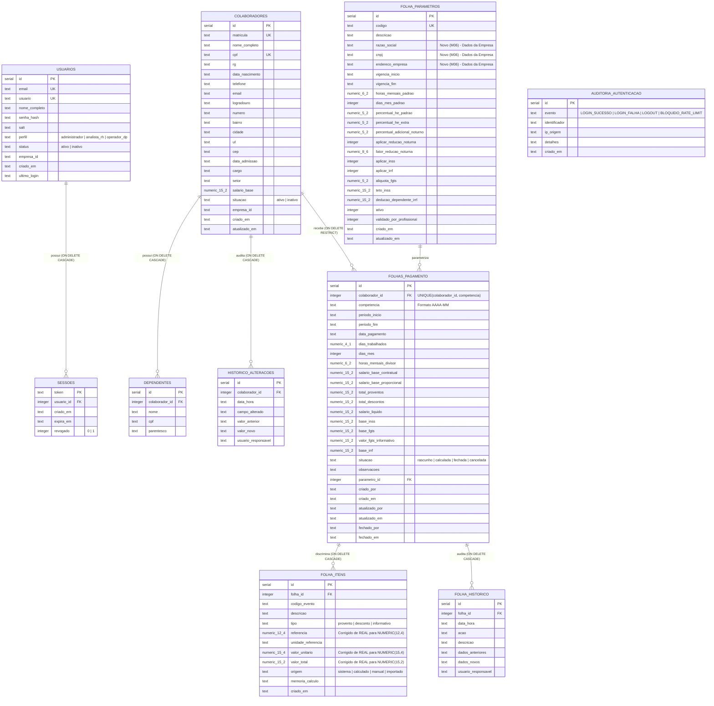
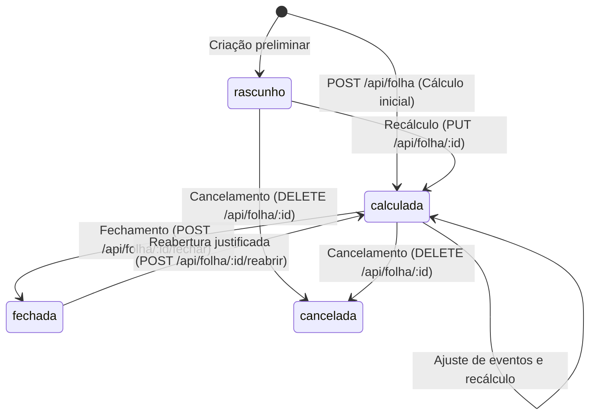

# 03 — Modelo de Dados e Integridade no Neon PostgreSQL

**Projeto:** RH2.0 — Portal de Departamento Pessoal & Folha de Pagamento  
**Data:** 18/11/2026

---

## 1. Diagrama Entidade-Relacionamento (ERD) do Modelo Atual + Evolução Mínima

---

## 2. Mapeamento dos Dados Obrigatórios (Seção 2.3)

Seguindo a diretriz de **não criar tabelas desnecessárias** e aproveitar os modelos já criados pelos alunos:

| Item Exigido (Seção 2.3) | Tabela Existente no Projeto | Situação e Ajuste Planejado |
|---|---|---|
| 1. Empresas e suas configurações | `folha_parametros` ( + `empresa_id` em `colaboradores`/`usuarios`) | **Complementar** com 3 colunas idempotentes em `folha_parametros` (`razao_social`, `cnpj`, `endereco_empresa`) para persistir os dados da empresa exibidos no holerite sem criar tabela extra desnecessária. |
| 2. Usuários e permissões | `usuarios` e `sessoes` | **Aproveitar** (`perfil IN ('administrador', 'analista_rh', 'operador_dp')`). |
| 3. Funcionários | `colaboradores` e `dependentes` | **Aproveitar** integralmente. |
| 4. Vínculos empregatícios | `colaboradores` (`matricula`, `data_admissao`, `situacao`) | **Aproveitar** integralmente. |
| 5. Dados contratuais | `colaboradores` (`cargo`, `setor`, `salario_base`) | **Aproveitar** integralmente. |
| 6. Histórico salarial | `historico_alteracoes` (`campo_alterado = 'Salário-base'`) | **Aproveitar** integralmente (já grava `valor_anterior` e `valor_novo` a cada alteração salarial). |
| 7. Competências | `folhas_pagamento.competencia` (`AAAA-MM`) | **Aproveitar** com constraint `UNIQUE (colaborador_id, competencia)`. |
| 8. Eventos e lançamentos | `folha_itens` + `catalogo_eventos.py` | **Corrigir** precisão de `REAL` para `NUMERIC` no PostgreSQL. |
| 9. Parâmetros de cálculo | `folha_parametros` | **Aproveitar** e liberar edição persistida pela interface. |
| 10. Resultados das folhas | `folhas_pagamento` | **Aproveitar** e corrigir serialização JSON de `Decimal` para `float`. |
| 11. Proventos | `folha_itens` (`tipo = 'provento'`) + `folhas_pagamento.total_proventos` | **Aproveitar** integralmente. |
| 12. Descontos | `folha_itens` (`tipo = 'desconto'`) + `folhas_pagamento.total_descontos` | **Aproveitar** integralmente. |
| 13. Bases de cálculo e incidências | `folhas_pagamento` (`base_inss`, `base_fgts`, `base_irrf`, `valor_fgts_informativo`) + `folha_itens` (`tipo = 'informativo'`) | **Aproveitar** integralmente. |
| 14. Estados de processamento | `folhas_pagamento.situacao` (`rascunho`, `calculada`, `fechada`, `cancelada`) | **Aproveitar** integralmente. |
| 15. Fechamentos | `folhas_pagamento` (`fechado_por`, `fechado_em`) + `folha_historico` (`acao = 'FECHAMENTO'`) | **Aproveitar** e adicionar endpoint de fechamento consolidado da competência. |
| 16. Demonstrativos e referências | `folhas_pagamento` + `folha_itens` (`memoria_calculo`) | **Aproveitar** e alimentar cabeçalho do holerite com os dados da empresa persistidos. |
| 17. Histórico de alterações | `historico_alteracoes` e `folha_historico` | **Aproveitar** integralmente. |
| 18. Informações de auditoria | `auditoria_autenticacao`, `historico_alteracoes`, `folha_historico` | **Aproveitar** integralmente. |

---

## 3. Precisão Monetária e Máquina de Estados do Fechamento (Seções 6.1 e 6.2)

### 3.1. Valores Monetários (`Decimal` e `NUMERIC`)
- No código Python (`backend/folha_calculos.py`), todos os cálculos já utilizam `decimal.Decimal` com quantização `Decimal("0.01")` e arredondamento `ROUND_HALF_UP`.
- No banco PostgreSQL (Neon), `colaboradores.salario_base`, `folha_parametros.*` e `folhas_pagamento.*` já utilizam `NUMERIC(15,2)`.
- **Correção obrigatória (`migrations/006_precisao_monetaria_e_empresa.sql`):**
  - Alterar `folha_itens.referencia` para `NUMERIC(12,4)`, `folha_itens.valor_unitario` para `NUMERIC(15,4)` e `folha_itens.valor_total` para `NUMERIC(15,2)` no PostgreSQL.
  - Garantir conversão determinística de `Decimal` para `float` (ou serializador JSON seguro) na saída de `FolhaService` e `ApiColaboradorHandler._enviar_json`.

### 3.2. Máquina de Estados da Folha e da Competência

**Regras de Integridade do Fechamento:**
1. **Prevenção de Duplicidade:** Constraint no banco `CONSTRAINT unq_colab_competencia UNIQUE (colaborador_id, competencia)`.
2. **Imutabilidade de Folha Fechada:** Qualquer tentativa de `PUT /api/folha/<id>`, `POST /api/folha/<id>/calcular`, `POST /api/folha/<id>/fechar` ou `DELETE /api/folha/<id>` quando `situacao == 'fechada'` levanta `FolhaBloqueadaException` (HTTP 403).
3. **Preservação de Histórico Salarial na Folha:** Quando uma folha é calculada, `salario_base_contratual` e `salario_base_proporcional` são gravados em `folhas_pagamento`. Uma alteração posterior no cadastro do colaborador (`colaboradores.salario_base`) **não altera nem invalida** folhas já calculadas ou fechadas.
4. **Reabertura Controlada:** Só é permitida mediante `motivo` com no mínimo 5 caracteres, gravando registro imutável em `folha_historico` com `data_hora`, `acao='REABERTURA'`, `descricao` e `usuario_responsavel`.

---

## 4. Estratégia de Migrações Versionadas (Seção 6.3)

- As migrações existentes (`001` a `005`) serão preservadas intactas.
- Será adicionada a migração **`migrations/006_precisao_monetaria_e_empresa.sql`**, 100% não-destrutiva e idempotente:
  - Adiciona `razao_social`, `cnpj` e `endereco_empresa` em `folha_parametros` (`ADD COLUMN IF NOT EXISTS`).
  - Converte as colunas `referencia`, `valor_unitario` e `valor_total` de `folha_itens` de `REAL` para `NUMERIC` (`ALTER COLUMN ... TYPE NUMERIC(...) USING ...`).
  - Cria tabela de controle `schema_migrations (versao TEXT PRIMARY KEY, aplicado_em TEXT NOT NULL)` para rastrear quais migrações já foram aplicadas no Neon e evitar reexecução desnecessária de DDL a cada requisição serverless.
- **Ressalva sobre Backups no Neon:** O recurso de restauração ponto no tempo (Point-in-Time Restore / History retention) no Neon depende do plano contratado da conta (Free Tier possui janela limitada de histórico, tipicamente 24h a 7 dias conforme a versão da conta). Não se deve presumir backup externo automático sem verificação no painel do Neon; por isso, todas as migrações são estritamente aditivas (sem `DROP` ou `TRUNCATE`).
