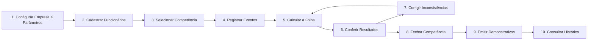

# 04 — Fluxo Ponta a Ponta da Folha de Pagamento

**Projeto:** RH2.0 — Portal de Departamento Pessoal & Folha de Pagamento  
**Data:** 18/11/2026

---

## Visão Geral da Jornada Operacional (Seção 8)

Abaixo está o mapeamento completo dos **10 passos operacionais** para que um usuário execute e feche a folha de pagamento de ponta a ponta, detalhando o que já existe no código dos alunos, o que falta, as tabelas envolvidas, os endpoints e os critérios de aceite.

---

### Passo 1 — Configurar a Empresa e Parâmetros de Cálculo
- **Funcionalidades existentes:** Endpoint `GET /api/folha/parametros` e `POST /api/folha/parametros` (`backend/server.py#L349,L508`); método `FolhaService.salvar_parametros()` (`backend/folha_service.py#L93`); modal `#modal-parametros-folha` (`frontend/index.html#L1258`).
- **Funcionalidades faltantes:**
  1. Campos de identificação da empresa (`razao_social`, `cnpj`, `endereco_empresa`) em `folha_parametros` e no modal `#modal-parametros-folha`.
  2. Remover o atributo `readonly` dos inputs de `#modal-parametros-folha` para usuários autorizados e adicionar o botão "Salvar Configurações" conectado a `POST /api/folha/parametros`.
- **Tabelas envolvidas:** `folha_parametros`.
- **Operações de banco:** `SELECT * FROM folha_parametros WHERE ativo = 1`, `UPDATE folha_parametros SET ...` / `INSERT INTO folha_parametros ...`.
- **Regras e validações:** Divisor de horas > 0, dias do mês entre 1 e 31, percentuais >= 0, CNPJ e Razão Social preenchidos.
- **Critério de aceite:** Ao atualizar a Razão Social, CNPJ ou parâmetros e clicar em Salvar, os dados são gravados no Neon, retornam no `GET /api/folha/parametros` após recarregar a página e aparecem automaticamente no cabeçalho dos holerites.

---

### Passo 2 — Cadastrar Funcionários
- **Funcionalidades existentes:** Cadastro completo de colaborador e dependentes, edição com justificativa auditada, listagem com busca e filtros por nome, matrícula, CPF, cargo, setor e situação (`backend/service.py`, `backend/validators.py`, `frontend/index.html#L237-L910`, `frontend/app.js#L402-L1013`).
- **Funcionalidades faltantes:** Garantir bloco transacional `try/except/finally` explícito em `ColaboradorService.cadastrar` e `atualizar` para fechar conexões com segurança em qualquer erro no Neon.
- **Tabelas envolvidas:** `colaboradores`, `dependentes`, `historico_alteracoes`.
- **Operações de banco:** `INSERT INTO colaboradores`, `INSERT INTO dependentes`, `INSERT INTO historico_alteracoes`, `UPDATE colaboradores`.
- **Regras e validações:** CPF válido (dígitos verificadores) e único, matrícula única, idade >= 14 anos, admissão >= nascimento + 14 anos, salário-base > 0.
- **Endpoints:** `GET /api/colaboradores`, `POST /api/colaboradores`, `GET /api/colaboradores/<id>`, `PUT /api/colaboradores/<id>`, `PATCH /api/colaboradores/<id>/inativar`, `PATCH /api/colaboradores/<id>/reativar`.
- **Critério de aceite:** Colaborador cadastrado pela UI persiste no Neon, aparece na listagem de colaboradores ativos e torna-se imediatamente elegível no seletor da folha (`GET /api/folha/colaboradores`).

---

### Passo 3 — Selecionar a Competência
- **Funcionalidades existentes:** Seletor `<input type="month" id="filtro-folha-competencia">` na barra da Folha (`frontend/index.html#L487`) e no modal de lançamento (`#folha-campo-competencia`), além de cards de métricas (`#stat-folha-total`, `#stat-folha-proventos`, `#stat-folha-descontos`, `#stat-folha-liquido`).
- **Funcionalidades faltantes:**
  1. Inicializar a competência padrão com o mês/ano atual ou último utilizado (em vez de fixo em `2026-10` se houver competência mais recente) mantendo facilidade de troca.
  2. Exibir um indicador claro de status da competência selecionada (ex.: quantos colaboradores ativos já possuem folha calculada/fechada na competência vs. quantos faltam processar).
- **Tabelas envolvidas:** `folhas_pagamento`, `colaboradores`.
- **Operações de banco:** `SELECT ... FROM folhas_pagamento WHERE competencia = %s`.
- **Endpoints:** `GET /api/folha?competencia=AAAA-MM`, `GET /api/folha/colaboradores`.
- **Critério de aceite:** Ao selecionar o mês/ano, a tela atualiza imediatamente a tabela e os totalizadores com os dados reais daquela competência vindos do Neon.

---

### Passo 4 — Registrar Eventos
- **Funcionalidades existentes:** Inputs diretos no modal `#modal-folha-form` para Horas Extras 50%, Horas Extras 100%, Adicional Noturno, Faltas em dias e Atrasos em horas (`frontend/index.html#L1007-L1036`), além de tabela dinâmica de rubricas avulsas (`#wrapper-rubricas-manuais`) alimentada pelos 82 eventos de `GET /api/folha/eventos-catalogo`.
- **Funcionalidades faltantes:**
  1. Corrigir `abrirModalEdicaoFolha` (`frontend/app.js#L1598-L1615`) para recarregar corretamente os códigos `'101'` (HE 50%), `'102'` (HE 100%), `'103'` (Adicional Noturno), `'201'` (Faltas), `'202'` (Atrasos) e **todas** as demais rubricas do catálogo lançadas pelo usuário (ex.: Insalubridade `'0030'`, Periculosidade `'0031'`, Vale-Transporte `'0510'`, Adiantamento `'0520'`), que hoje são perdidas ao abrir o modal de edição.
- **Tabelas envolvidas:** `folha_itens`.
- **Endpoints:** `GET /api/folha/eventos-catalogo`, `POST /api/folha`, `PUT /api/folha/<id>`.
- **Critério de aceite:** Eventos informados pelo usuário (tanto nos campos rápidos quanto na lista de rubricas do catálogo) são enviados ao backend, calculados, gravados em `folha_itens` e recuperados integralmente ao abrir a folha para edição.

---

### Passo 5 — Calcular a Folha (Individual e em Lote)
- **Funcionalidades existentes:** Cálculo individual completo via `POST /api/folha` e recálculo via `PUT /api/folha/<id>` ou `POST /api/folha/<id>/calcular`, executando `processar_calculo_folha()` (`backend/folha_calculos.py`).
- **Funcionalidades faltantes:**
  1. Corrigir a serialização de `Decimal` em `backend/folha_service.py` e `backend/server.py` para que o cálculo em PostgreSQL/Neon retorne HTTP 200/201 sem `TypeError`.
  2. Adicionar endpoint `POST /api/folha/gerar-lote` (e botão "Gerar Folhas da Competência" na UI) que gera/calcula automaticamente a folha mensal padrão para todos os colaboradores ativos que ainda não possuem folha na competência selecionada, poupando o usuário de cadastrar um por um quando não há eventos variáveis.
  3. Alinhar a prévia do formulário (`atualizarPreviaCalculo` / botão "Simular / Recalcular") com as faixas de INSS e IRRF de 2026 ou endpoint `POST /api/folha/simular`.
- **Tabelas envolvidas:** `folhas_pagamento`, `folha_itens`, `folha_historico`, `folha_parametros`, `colaboradores`, `dependentes`.
- **Critério de aceite:** O cálculo persiste cabeçalho, itens e memória de cálculo no Neon com `situacao = 'calculada'`, respeitando a equação $\text{Salário Líquido} = \text{Total Proventos} - \text{Total Descontos}$.

---

### Passo 6 — Conferir Resultados
- **Funcionalidades existentes:** Cards de resumo da competência (`Total de Folhas`, `Total de Proventos`, `Total de Descontos`, `Total Líquido`), listagem por colaborador e modal de Demonstrativo (`#modal-holerite`) com tabela de vencimentos/descontos, rodapé de bases (`Salário-Base`, `Base INSS`, `Base FGTS`, `FGTS do Mês`, `Base IRRF`) e seção expansível "Memória Detalhada de Cálculo".
- **Funcionalidades faltantes:** Exibir nos cards ou barra da competência o status geral da competência (ex.: quantas folhas estão `calculada` vs `fechada` e quantos colaboradores ativos estão pendentes).
- **Tabelas envolvidas:** `folhas_pagamento`, `folha_itens`, `folha_historico`.
- **Endpoints:** `GET /api/folha?competencia=AAAA-MM`, `GET /api/folha/<id>`.
- **Critério de aceite:** O usuário visualiza todos os proventos, descontos, bases de INSS/FGTS/IRRF e a memória de cálculo passo a passo de cada rubrica diretamente dos dados salvos no Neon.

---

### Passo 7 — Corrigir Inconsistências e Recalcular
- **Funcionalidades existentes:** Botão de edição na linha da folha (quando `situacao != 'fechada'`), que abre `#modal-folha-form` e submete `PUT /api/folha/<id>`, substituindo os `folha_itens` e gravando `acao = 'RECALCULO'` em `folha_historico`. Caso a folha já esteja fechada, o sistema oferece o botão de Reabertura com justificativa obrigatória (`POST /api/folha/<id>/reabrir`).
- **Funcionalidades faltantes:** Corrigir o carregamento dos itens no modal de edição (Defeito D-04) para que nenhum evento anterior seja perdido durante o ajuste.
- **Tabelas envolvidas:** `folhas_pagamento`, `folha_itens`, `folha_historico`.
- **Critério de aceite:** Ao editar uma folha calculada, alterar um lançamento (ex.: adicionar horas extras ou remover falta) e salvar, os novos valores substituem os anteriores de forma transacional no Neon e o histórico registra `RECALCULO`.

---

### Passo 8 — Fechar a Competência
- **Funcionalidades existentes:** Fechamento individual de cada folha (`POST /api/folha/<id>/fechar`) com modal de confirmação (`#modal-fechar-folha-confirm`), gravando `situacao = 'fechada'`, `fechado_por`, `fechado_em` e registro `FECHAMENTO` em `folha_historico`.
- **Funcionalidades faltantes:** Adicionar ação/endpoint de **Fechar Competência Completa** (`POST /api/folha/fechar-competencia`), permitindo fechar de uma só vez todas as folhas `calculada` da competência selecionada, com resumo prévio de confirmação.
- **Tabelas envolvidas:** `folhas_pagamento`, `folha_historico`.
- **Critério de aceite:** Após o fechamento, a situação muda para `fechada` no Neon, os botões de edição e exclusão ficam bloqueados (tanto na UI quanto no backend via HTTP 403), e qualquer tentativa de alteração sem reabertura formal é rejeitada.

---

### Passo 9 — Emitir Documentos (Demonstrativos / Contracheques)
- **Funcionalidades existentes:** Modal `#modal-holerite` com layout oficial de Recibo de Pagamento de Salário (`#holerite-documento-imprimivel`) e botão "Imprimir Demonstrativo" (`window.print()` com estilos `@media print` em `frontend/styles.css`).
- **Funcionalidades faltantes:** Preencher dinamicamente o nome da empresa, CNPJ e endereço no cabeçalho do holerite a partir dos dados persistidos em `folha_parametros` (em vez do texto estático `PORTAL DP & RH LTDA`).
- **Tabelas envolvidas:** `folhas_pagamento`, `folha_itens`, `folha_parametros`, `colaboradores`.
- **Critério de aceite:** O demonstrativo emitido reflete fielmente os dados da empresa configurada, os dados do colaborador, todas as rubricas e os totais da folha fechada no Neon.

---

### Passo 10 — Consultar o Histórico
- **Funcionalidades existentes:** Filtro de competência (`#filtro-folha-competencia`), filtro de situação (`Fechadas`, `Calculadas`, `Todas`), busca por colaborador/CPF/matrícula e visualização completa do holerite e da trilha de auditoria (`#h-auditoria-timeline`) de qualquer competência passada, além do histórico cadastral em `GET /api/colaboradores/<id>/historico`.
- **Funcionalidades faltantes:** Nenhuma funcionalidade estrutural ausente; depende apenas da correção da serialização `Decimal` (Defeito D-01) e da conexão ativa com o Neon.
- **Tabelas envolvidas:** `folhas_pagamento`, `folha_itens`, `folha_historico`, `historico_alteracoes`.
- **Critério de aceite:** Após encerrar a sessão, reiniciar o servidor/redeployar na Vercel e fazer novo login, o usuário seleciona uma competência anterior e recupera integralmente as folhas fechadas, seus demonstrativos e sua trilha de auditoria diretamente do Neon PostgreSQL.
