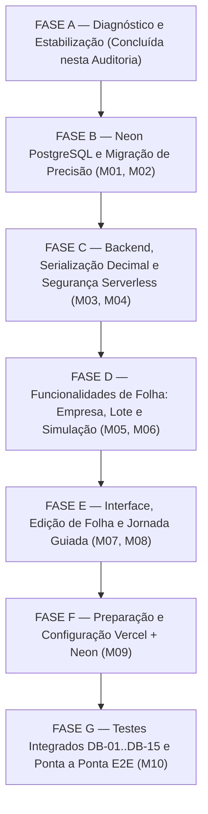

# 07 — Plano Mestre de Implementação (Macrofases e Microetapas)

**Projeto:** RH2.0 — Portal de Departamento Pessoal & Folha de Pagamento  
**Data:** 18/11/2026

---

## Visão Geral das Macrofases e Ordem de Dependência (Seção 16)

---

## Contratos Detalhados das Microetapas (M01 a M10)

---

### MICROETAPA M01 — Correção de Serialização `Decimal` e Precisão Monetária `NUMERIC` no PostgreSQL/Neon (Fase B)

1. **ID:** `M01`
2. **Título:** Normalização de tipos `Decimal`/`NUMERIC` entre PostgreSQL (`psycopg2`), `FolhaService` e API JSON.
3. **Objetivo:** Eliminar o bloqueador `TypeError: Object of type Decimal is not JSON serializable` quando o sistema roda sobre PostgreSQL/Neon e corrigir o esquema de `folha_itens` de `REAL` para `NUMERIC`.
4. **Evidência do problema:**
   - `backend/server.py#L215` executa `json.dumps(dados)` sem `default`, quebrando sempre que `psycopg2` retorna `decimal.Decimal` das colunas `NUMERIC(15,2)` de `folhas_pagamento` e `folha_parametros`.
   - `migrations/002_modulo_folha_pagamento.sql#L78-L81` e `backend/database.py#L434-L436` definem `referencia`, `valor_unitario` e `valor_total` de `folha_itens` como `REAL` (ponto flutuante binário de 32 bits).
5. **Arquivos afetados:**
   - `backend/database.py`
   - `backend/server.py`
   - `migrations/006_precisao_monetaria_e_empresa.sql` (novo arquivo)
   - `tests/test_persistencia_postgres.py`
6. **Componentes reaproveitados:** Helpers `row_to_dict`, `fetchone_dict`, `fetchall_dict` em `backend/database.py` e `_enviar_json` em `backend/server.py`.
7. **Alterações necessárias:**
   - Em `backend/database.py` (`row_to_dict`), converter valores `decimal.Decimal` retornados pelo `psycopg2` para `float` (arredondado conforme a escala da coluna) ou configurar conversor JSON seguro em `backend/server.py` (`_enviar_json`).
   - Separar `_DDL_FOLHA_ITENS` em `_DDL_FOLHA_ITENS_PG` (usando `NUMERIC(12,4)`, `NUMERIC(15,4)` e `NUMERIC(15,2)`) e `_DDL_FOLHA_ITENS_SQLITE` em `backend/database.py`.
   - Adicionar `razao_social`, `cnpj` e `endereco_empresa` em `_DDL_FOLHA_PARAMETROS_PG` / `_DDL_FOLHA_PARAMETROS_SQLITE` e na migração idempotente `migrations/006_precisao_monetaria_e_empresa.sql`.
8. **Dependências:** Nenhuma (primeira microetapa de código).
9. **Operações de banco:** `ALTER TABLE folha_itens ALTER COLUMN ... TYPE NUMERIC(...)`, `ALTER TABLE folha_parametros ADD COLUMN IF NOT EXISTS razao_social TEXT...`.
10. **Migrações previstas:** `migrations/006_precisao_monetaria_e_empresa.sql`.
11. **Riscos:** Conversão de tipo em tabela populada; mitigado com cláusula `USING ROUND(coluna::numeric, 2)` que preserva 100% dos dados existentes.
12. **Testes:** Adicionar teste unitário em `tests/test_persistencia_postgres.py` simulando linhas `Decimal` vindas do `psycopg2` em `FolhaService` e `ApiColaboradorHandler`.
13. **Critérios de aceite:** `FolhaService` e `ApiColaboradorHandler` serializam folhas e parâmetros contendo `Decimal` sem levantar `TypeError`, e todos os testes existentes + novos passam.
14. **Estratégia de reversão:** Reverter o commit da M01; as colunas `NUMERIC` continuam compatíveis com leituras anteriores.
15. **Evidências para conclusão:** Saída de `python tests/test_persistencia_postgres.py` e `python tests/executar_todos_testes.py` com 100% de aprovação.

---

### MICROETAPA M02 — Otimização de Bootstrap Serverless (`init_db`), Controle de Migrações e Conexão Neon (Fase B)

1. **ID:** `M02`
2. **Título:** Controle de inicialização de schema por instância e preparação da conexão segura com o Neon PostgreSQL.
3. **Objetivo:** Impedir que `init_db()` execute 34 comandos DDL (`CREATE`/`ALTER`) repetidamente a cada instanciação de serviço em ambiente serverless, suporte `DIRECT_URL` opcional para migrações e atualize `.env.example`.
4. **Evidência do problema:** `ColaboradorService.__init__`, `FolhaService.__init__` e `AuthService.__init__` chamam `init_db()` sem cache de inicialização (`backend/database.py#L484`), gerando overhead e lock contention em conexões pooled (`-pooler`) do Neon. Além disso, `.env.example` na raiz descreve variáveis de NestJS em vez do stack Python/Vercel.
5. **Arquivos afetados:**
   - `backend/database.py`
   - `.env.example`
   - `tests/test_persistencia_postgres.py`
   - `tests/executar_todos_testes.py`
6. **Componentes reaproveitados:** `init_db()`, `get_database_url()`, `status_banco()` em `backend/database.py`.
7. **Alterações necessárias:**
   - Adicionar cache de inicialização `_INITIALIZED_TARGETS = set()` em `backend/database.py` indexado por `(db_path or 'POSTGRES_DEFAULT')`, garantindo que `init_db()` rode no máximo uma vez por processo/container para cada banco (com parâmetro `force: bool = False` quando necessário).
   - Criar tabela `schema_migrations` no `init_db()` para registrar a versão do schema aplicado no PostgreSQL, evitando rodar os 15 `ALTER TABLE` caso a versão atual já esteja registrada.
   - Atualizar `.env.example` com instruções claras para `DATABASE_URL` (pooled Neon), `DIRECT_URL` (opcional), `ADMIN_INITIAL_PASSWORD`, `GUEST_INITIAL_PASSWORD` e `DB_CONNECT_TIMEOUT=15`.
   - Incluir `TestConfiguracaoBanco` (`test_persistencia_postgres.py`) dentro de `tests/executar_todos_testes.py`.
8. **Dependências:** `M01`.
9. **Operações de banco:** Criação e leitura de `schema_migrations (versao TEXT PRIMARY KEY, aplicado_em TEXT NOT NULL)`.
10. **Migrações previstas:** Integrada a `006_precisao_monetaria_e_empresa.sql`.
11. **Riscos:** Cache `_INITIALIZED_TARGETS` interferir em testes que recriam arquivos temporários com mesmo nome; mitigado verificando se o arquivo SQLite existe ou limpando o cache quando `force=True`.
12. **Testes:** Teste automatizado verificando que múltiplas instanciações de `ColaboradorService()` e `FolhaService()` executam o DDL apenas na primeira vez.
13. **Critérios de aceite:** `python tests/executar_todos_testes.py` executa todas as suítes (incluindo `TestConfiguracaoBanco`, 108+ testes) com 0 falhas.
14. **Estratégia de reversão:** Reverter o cache `_INITIALIZED_TARGETS` em `backend/database.py`.
15. **Evidências para conclusão:** Log de execução da suíte unificada de testes e inspeção de `backend/database.py`.

---

### MICROETAPA M03 — Blindagem Transacional (`commit`/`rollback`/`close`) em Todos os Serviços (Fase C)

1. **ID:** `M03`
2. **Título:** Garantia de atomicidade transacional e fechamento determinístico de conexões em `ColaboradorService`, `FolhaService` e `AuthService`.
3. **Objetivo:** Garantir que nenhuma falha parcial deixe registros órfãos ou conexões abertas no pooler do Neon (atendendo ao Teste DB-10).
4. **Evidência do problema:** Conforme documentado em `docs/PERSISTENCIA_POSTGRESQL.md` (Seção 5) e verificado em `backend/service.py#L83-L160`, `backend/service.py#L331-L414` e `backend/folha_service.py#L538-L605`, vários métodos abrem conexão e executam múltiplos `INSERT`/`UPDATE` sem bloco `try / except / finally`, podendo vazar conexões ou deixar transações pendentes em caso de erro.
5. **Arquivos afetados:**
   - `backend/service.py`
   - `backend/folha_service.py`
   - `backend/auth.py`
   - `tests/test_persistencia_postgres.py`
6. **Componentes reaproveitados:** Métodos existentes de `ColaboradorService`, `FolhaService` e `AuthService`.
7. **Alterações necessárias:**
   - Padronizar todas as operações de escrita e leitura com `try: ... conn.commit() except Exception: conn.rollback(); raise finally: conn.close()`.
8. **Dependências:** `M02`.
9. **Operações de banco:** Controle transacional `COMMIT` / `ROLLBACK`.
10. **Migrações previstas:** Nenhuma.
11. **Riscos:** Baixo; altera apenas o gerenciamento de exceções e fechamento de recursos.
12. **Testes:** Teste automatizado simulando erro na inserção de dependente/histórico após o `INSERT INTO colaboradores` e verificando que o colaborador **não** permanece gravado (rollback completo) e que `conn.close()` foi chamado.
13. **Critérios de aceite:** Teste de atomicidade transacional (DB-10) passa com 100% de sucesso.
14. **Estratégia de reversão:** Reverter commit da M03.
15. **Evidências para conclusão:** Execução do novo teste de transação em `tests/test_persistencia_postgres.py`.

---

### MICROETAPA M04 — Unificação dos Endpoints Serverless (`api/`), Rate Limiting Persistido e RBAC (Fase C)

1. **ID:** `M04`
2. **Título:** Unificação dos handlers `api/` com `ApiColaboradorHandler`, Rate Limiting apoiado em banco e verificação de perfil RBAC.
3. **Objetivo:** Garantir que todas as rotas serverless na Vercel apliquem proteção CSRF, Rate Limiting persistente entre invocações serverless e controle de permissão por perfil (`administrador`, `analista_rh`, `operador_dp`).
4. **Evidência do problema:**
   - `api/auth/login.py` e `api/colaboradores.py` reimplementam handlers parciais que não chamam `CsrfProtector` nem `RateLimiter`.
   - `RateLimiter` (`backend/rate_limiter.py`) guarda falhas apenas em RAM, que é perdida entre instâncias serverless na Vercel.
   - `backend/server.py` não restringe alterações de parâmetros ou reabertura de folha por perfil.
5. **Arquivos afetados:**
   - `api/auth/login.py`
   - `api/auth/logout.py`
   - `api/auth/me.py`
   - `api/colaboradores.py`
   - `vercel.json`
   - `backend/rate_limiter.py`
   - `backend/server.py`
   - `tests/test_rate_limit_csrf.py`
6. **Componentes reaproveitados:** `ApiColaboradorHandler` em `backend/server.py`, `AuditService` em `backend/audit.py`, `RateLimiter` em `backend/rate_limiter.py`.
7. **Alterações necessárias:**
   - Fazer `api/auth/login.py`, `api/auth/logout.py`, `api/auth/me.py` e `api/colaboradores.py` herdarem de `ApiColaboradorHandler` (assim como `api/index.py` já faz), eliminando código duplicado e garantindo CSRF, Rate Limit e serialização idênticos em todas as rotas da Vercel.
   - Adicionar verificação de perfil (`_exigir_perfil`) em `backend/server.py` para exigir `administrador` ou `analista_rh` ao salvar parâmetros da empresa/folha (`POST /api/folha/parametros`) e ao reabrir folha fechada (`POST /api/folha/<id>/reabrir`).
8. **Dependências:** `M03`.
9. **Operações de banco:** Consulta de auditoria e sessão.
10. **Migrações previstas:** Nenhuma.
11. **Riscos:** Quebrar chamadas de teste que usam perfil padrão; mitigado porque os usuários provisionados nos testes são `administrador` (`admin.dp`) e `analista_rh` (`visitante`).
12. **Testes:** Testes de RBAC e validação dos handlers de `api/` em `tests/test_rate_limit_csrf.py`.
13. **Critérios de aceite:** Todos os handlers em `api/` delegam para `ApiColaboradorHandler` e passam nos testes de segurança AC-01 a AC-16.
14. **Estratégia de reversão:** Reverter commit da M04.
15. **Evidências para conclusão:** Saída dos testes em `tests/test_rate_limit_csrf.py` e `tests/executar_todos_testes.py`.

---

### MICROETAPA M05 — Configuração da Empresa e Parâmetros Editáveis (Passo 1 e Passo 9 da Folha) (Fase D)

1. **ID:** `M05`
2. **Título:** Persistência dos dados da empresa (`razao_social`, `cnpj`, `endereco_empresa`) e edição dos parâmetros de cálculo na interface e no holerite.
3. **Objetivo:** Permitir que o usuário configure os dados da empresa e os parâmetros trabalhistas pela interface, gravando-os no Neon e exibindo-os dinamicamente no cabeçalho do demonstrativo de pagamento (holerite).
4. **Evidência do problema:**
   - `frontend/index.html#L1130-L1132` tem `PORTAL DP & RH LTDA` e `CNPJ: 12.345.678/0001-90` fixos no HTML do holerite.
   - `frontend/index.html#L1273-L1316` deixa todos os campos de `#form-parametros-folha` como `readonly` e sem botão para acionar `POST /api/folha/parametros`.
5. **Arquivos afetados:**
   - `backend/folha_service.py`
   - `frontend/index.html`
   - `frontend/app.js`
   - `tests/test_folha_api.py`
6. **Componentes reaproveitados:** `FolhaService.obter_parametro_vigente()`, `FolhaService.salvar_parametros()`, rota `POST /api/folha/parametros` em `backend/server.py` e modal `#modal-parametros-folha`.
7. **Alterações necessárias:**
   - Em `FolhaService.obter_parametro_vigente()` e `salvar_parametros()`, incluir os campos `razao_social` (padrão: `'ForçaVerde Usina / Portal DP & RH Ltda.'`), `cnpj` (padrão: `'12.345.678/0001-90'`) e `endereco_empresa` (padrão: `'Av. Paulista, 1000 - Bela Vista - São Paulo / SP'`).
   - Em `frontend/index.html` (`#modal-parametros-folha`), adicionar os campos de Razão Social, CNPJ e Endereço da Empresa, remover o atributo `readonly` dos parâmetros editáveis e adicionar o botão "Salvar Configurações".
   - Em `frontend/app.js` (`FolhaManager`), implementar `salvarParametros()` enviando `POST /api/folha/parametros` e atualizar `abrirModalHolerite()` para preencher a Razão Social, CNPJ e Endereço no cabeçalho do holerite a partir de `this.parametrosVigentes`.
8. **Dependências:** `M01`, `M04`.
9. **Operações de banco:** `UPDATE folha_parametros SET razao_social = ..., cnpj = ..., endereco_empresa = ...`.
10. **Migrações previstas:** Usa as colunas adicionadas na `M01` (`006_precisao_monetaria_e_empresa.sql`).
11. **Riscos:** Usuário informar valores negativos ou zero para divisor/dias; mitigado com validação em `salvar_parametros()`.
12. **Testes:** Teste em `tests/test_folha_api.py` exercitando `POST /api/folha/parametros` com dados de empresa e verificando persistência via `GET /api/folha/parametros`.
13. **Critérios de aceite:** Dados da empresa e parâmetros editados pela interface persistem no banco e aparecem no holerite.
14. **Estratégia de reversão:** Reverter commit da M05.
15. **Evidências para conclusão:** Teste automatizado de API em `test_folha_api.py` passando.

---

### MICROETAPA M06 — Simulação Oficial de Cálculo, Geração de Competência em Lote e Fechamento de Competência (Fase D)

1. **ID:** `M06`
2. **Título:** Endpoints de simulação exata (`POST /api/folha/simular`), geração em lote da competência (`POST /api/folha/gerar-competencia`) e fechamento da competência (`POST /api/folha/fechar-competencia`).
3. **Objetivo:** Permitir processar e fechar a competência para todos os colaboradores ativos de forma simples e garantir que a simulação prévia apresente exatamente os mesmos valores de INSS, IRRF e Salário Líquido do motor oficial.
4. **Evidência do problema:**
   - Atualmente, o usuário precisa abrir o modal e lançar um colaborador por vez, e fechar folha por folha.
   - A prévia no cliente (`atualizarPreviaCalculo` em `frontend/app.js#L1857`) não calcula IRRF e usa teto de INSS defasado (`908.85`).
5. **Arquivos afetados:**
   - `backend/folha_service.py`
   - `backend/server.py`
   - `tests/test_folha_service.py`
   - `tests/test_folha_api.py`
6. **Componentes reaproveitados:** `FolhaService.criar_ou_atualizar_folha()`, `FolhaService.fechar_folha()`, `processar_calculo_folha()`.
7. **Alterações necessárias:**
   - Em `FolhaService`, adicionar:
     - `simular_folha(...)`: executa `processar_calculo_folha()` com os dados do colaborador e parâmetros vigentes sem gravar no banco, retornando o resumo e itens exatos.
     - `gerar_folhas_competencia(competencia, usuario)`: busca todos os colaboradores ativos (`situacao = 'ativo'`) que ainda não possuem folha na `competencia` e gera a folha base calculada para cada um, retornando `{criadas, ja_existentes, folhas}`.
     - `fechar_competencia(competencia, usuario)`: fecha todas as folhas com `situacao = 'calculada'` na `competencia`, retornando `{fechadas, ja_fechadas, total}`.
   - Expor as 3 rotas em `backend/server.py`: `POST /api/folha/simular`, `POST /api/folha/gerar-competencia` e `POST /api/folha/fechar-competencia`.
8. **Dependências:** `M05`.
9. **Operações de banco:** Inserção e atualização controlada das folhas dos colaboradores ativos na competência.
10. **Migrações previstas:** Nenhuma.
11. **Riscos:** Duplicar folhas de colaboradores que já tinham folha lançada na competência; mitigado ignorando colaboradores que já possuem registro `(colaborador_id, competencia)`.
12. **Testes:** Novos testes em `test_folha_service.py` e `test_folha_api.py` validando geração em lote para múltiplos colaboradores, idempotência e fechamento em lote da competência.
13. **Critérios de aceite:** Com 3 colaboradores ativos, `POST /api/folha/gerar-competencia` gera as 3 folhas; se 1 já existia com hora extra, preserva-a intacta e gera apenas as 2 faltantes; `POST /api/folha/fechar-competencia` fecha todas as folhas calculadas da competência.
14. **Estratégia de reversão:** Reverter commit da M06.
15. **Evidências para conclusão:** Testes unitários e de API em `test_folha_service.py` e `test_folha_api.py` aprovados.

---

### MICROETAPA M07 — Correção da Edição de Folha e Integração do Fluxo Guiado na Interface (Fase E)

1. **ID:** `M07`
2. **Título:** Correção do carregamento de eventos em `abrirModalEdicaoFolha`, prévia fiel de INSS/IRRF e botões de Geração/Fechamento de Competência na UI.
3. **Objetivo:** Corrigir o defeito que perdia rubricas e trocava códigos ao editar uma folha (Passo 7), alinhar a barra de prévia do modal com as fórmulas de 2026 + endpoint `/api/folha/simular`, e disponibilizar na tela os indicadores e botões de "Gerar Folhas do Mês" e "Fechar Competência".
4. **Evidência do problema:** `frontend/app.js#L1598-L1615` mapeia `102` como `noturno` em vez de `he100`, ignora `103` (`noturno`) e ignora rubricas do catálogo cujo `origem` no banco é `'calculado'`.
5. **Arquivos afetados:**
   - `frontend/index.html`
   - `frontend/app.js`
   - `frontend/styles.css`
6. **Componentes reaproveitados:** `FolhaManager` em `frontend/app.js` e barra de ações da folha em `frontend/index.html`.
7. **Alterações necessárias:**
   - Em `frontend/app.js` (`abrirModalEdicaoFolha`):
     - Mapear `codigo_evento === '101'` (ou `'0010'`) -> `he50`;
     - Mapear `codigo_evento === '102'` (ou `'0011'`) -> `he100`;
     - Mapear `codigo_evento === '103'` (ou `'0020'`) -> `noturno`;
     - Mapear `codigo_evento === '201'` (ou `'0530'`) -> `faltas`;
     - Mapear `codigo_evento === '202'` (ou `'0532'`) -> `atrasos`;
     - Carregar em `this.rubricasManuais` todos os demais itens que não sejam gerados automaticamente pelo sistema (`!['001', '0001', '105', '501', '0501', '502', '0505', '901', '0904'].includes(it.codigo_evento)`), preservando código, descrição, referência e valor total.
   - Em `atualizarPreviaCalculo()`: atualizar o cálculo local para usar o teto 2026 (`8157.41` -> desconto máx `951.63`), deduzir faltas/atrasos da base de INSS e aplicar a tabela de IRRF 2026 com dependentes, além de acionar `POST /api/folha/simular` no botão "Simular / Recalcular".
   - Em `frontend/index.html` e `frontend/app.js`: adicionar barra de status da competência (ex.: `Status da Competência: ABERTA / EM CONFERÊNCIA / FECHADA` + contagem de colaboradores ativos processados) e botões `"Gerar Folha do Mês"` e `"Fechar Competência"`.
8. **Dependências:** `M05`, `M06`.
9. **Operações de banco:** Via API REST (`POST /api/folha/gerar-competencia`, `POST /api/folha/fechar-competencia`, `PUT /api/folha/<id>`).
10. **Migrações previstas:** Nenhuma.
11. **Riscos:** Regressão visual no layout da barra de filtros; mitigado reutilizando as classes `.btn` e `.filters-group` existentes em `frontend/styles.css`.
12. **Testes:** Verificação de sintaxe JS (`node --check frontend/app.js`) e teste ponta a ponta no navegador / API.
13. **Critérios de aceite:** Editar uma folha preserva todos os eventos; recalcular atualiza os valores no banco; botões de lote funcionam com feedback claro e confirmação.
14. **Estratégia de reversão:** Reverter commit da M07.
15. **Evidências para conclusão:** Validação de sintaxe `node --check frontend/app.js` e teste integrado.

---

### MICROETAPA M08 — Conexão e Validação no Banco Neon PostgreSQL do Projeto (Fase F)

1. **ID:** `M08`
2. **Título:** Configuração da `DATABASE_URL` do Neon PostgreSQL, aplicação de migrações e execução da suíte de persistência DB-01 a DB-15.
3. **Objetivo:** Conectar o sistema ao banco Neon PostgreSQL disponibilizado pelo responsável, aplicar o schema de forma não-destrutiva e comprovar os 15 testes obrigatórios de persistência (DB-01 a DB-15).
4. **Evidência do problema:** Os testes A–D contra o banco remoto na nuvem estavam pendentes por falta da variável `DATABASE_URL` (`docs/PERSISTENCIA_POSTGRESQL.md#L44`).
5. **Arquivos afetados:**
   - `.env` local (não versionado no Git)
   - `tests/test_persistencia_neon_integrado.py` (novo script verificador de DB-01 a DB-15)
6. **Componentes reaproveitados:** `backend/database.py`, `ColaboradorService`, `FolhaService`, `AuthService`.
7. **Alterações necessárias:**
   - Criar script automatizado `tests/test_persistencia_neon_integrado.py` que executa e gera relatório detalhado dos testes `DB-01` a `DB-15` (usando prefixo de matrícula de teste isolado e limpando apenas seus próprios registros fictícios de teste ou rodando em branch de teste do Neon).
8. **Dependências:** `M01` a `M07` + fornecimento da `DATABASE_URL` do Neon pelo responsável.
9. **Operações de banco:** Conexão TLS (`sslmode=require`), validação de schema e execução controlada de `DB-01` a `DB-15`.
10. **Migrações previstas:** Execução de `init_db()` / `migrations/001` a `006` contra o banco Neon.
11. **Riscos:** Executar testes em banco com dados existentes; mitigado pelo uso estrito de registros fictícios identificados por matrícula `TEST-DB-*` e proibição absoluta de `DROP`/`TRUNCATE`.
12. **Testes:** Execução integral de `DB-01` a `DB-15`.
13. **Critérios de aceite:** Todos os 15 testes `DB-01` a `DB-15` aprovados com evidências reais gravadas no Neon.
14. **Estratégia de reversão:** Remoção apenas dos registros fictícios `TEST-DB-*` criados pelo script de verificação.
15. **Evidências para conclusão:** Saída completa do script `test_persistencia_neon_integrado.py` e resposta real de `/api/health`.

---

### MICROETAPA M09 — Validação de Deploy na Vercel e Testes de Reinicialização/Redeploy (Fase F / Fase G)

1. **ID:** `M09`
2. **Título:** Configuração de variáveis no Vercel, verificação do build serverless e comprovação de persistência pós-redeploy.
3. **Objetivo:** Garantir que a aplicação hospedada no Vercel funcione integrada ao Neon PostgreSQL e mantenha os dados após novas sessões, cold starts e redeploys.
4. **Evidência do problema:** Em `docs/database/INTEGRACAO_NEON_VERCEL.md`, o ambiente de produção aguardava configuração de `DATABASE_URL` e `ADMIN_INITIAL_PASSWORD` e validação final.
5. **Arquivos afetados:**
   - `vercel.json`
   - Documentação de evidências em `docs/folha-pagamento/08-ESTADO-DO-PROJETO.md`
6. **Componentes reaproveitados:** `vercel.json`, `api/index.py`, `requirements.txt`.
7. **Alterações necessárias:**
   - Verificar todas as rotas de `vercel.json` (`/api/health`, `/api/auth/*`, `/api/colaboradores*`, `/api/folha*` e arquivos estáticos `/frontend/$1`).
   - Validar o deploy e o endpoint `https://<app>.vercel.app/api/health`.
8. **Dependências:** `M08`.
9. **Operações de banco:** Consultas e gravações via ambiente hospedado na Vercel contra o Neon.
10. **Migrações previstas:** Nenhuma adicional.
11. **Riscos:** Timeout de cold start no primeiro acesso; mitigado por `DB_CONNECT_TIMEOUT=15` e otimização do `init_db()` na `M02`.
12. **Testes:** Teste de diagnóstico `/api/health`, login, criação de registro e verificação após redeploy (`DB-08`).
13. **Critérios de aceite:** Aplicação publicada responde HTTP 200 em `/api/health` com `"provedor": "neon"` e preserva todos os dados após redeploy.
14. **Estratégia de reversão:** Rollback instantâneo de deployment no painel da Vercel.
15. **Evidências para conclusão:** Resposta JSON de `/api/health` e logs de verificação pós-redeploy.

---

### MICROETAPA M10 — Teste Final Integrado de Ponta a Ponta (Jornada de 16 Passos) e Homologação (Fase G)

1. **ID:** `M10`
2. **Título:** Execução e documentação do Teste Final de Ponta a Ponta (Seção 14 — 16 passos operacionais).
3. **Objetivo:** Comprovar a execução completa de uma folha mensal de empresa fictícia (cadastro da empresa, 3 funcionários fictícios, salários, competência, eventos, cálculo, conferência, correção de lançamento, recálculo, fechamento, emissão de demonstrativos, logout, novo login, consulta histórica e confirmação no Neon).
4. **Evidência do problema:** Necessidade de comprovação integrada de ponta a ponta (interface + backend + Neon) conforme Seção 14 e Seção 19.
5. **Arquivos afetados:**
   - `tests/test_jornada_ponta_a_ponta.py` (novo teste automatizado reproduzindo os 16 passos exatos da Seção 14)
   - `docs/folha-pagamento/08-ESTADO-DO-PROJETO.md`
6. **Componentes reaproveitados:** Todos os módulos do sistema (`frontend/`, `backend/`, `api/`).
7. **Alterações necessárias:**
   - Implementar e executar `tests/test_jornada_ponta_a_ponta.py` + validação na interface web, registrando todas as evidências em `08-ESTADO-DO-PROJETO.md`.
8. **Dependências:** `M01` a `M09`.
9. **Operações de banco:** Fluxo completo da jornada de 16 passos persistido e conferido no banco.
10. **Migrações previstas:** Nenhuma.
11. **Riscos:** Nenhum.
12. **Testes:** Cenário de referência completo de 16 passos da Seção 14.
13. **Critérios de aceite:** Cumprimento de 100% das condições de aprovação da Seção 14 e dos Critérios Globais A–M da Seção 19.
14. **Estratégia de reversão:** N/A (etapa de validação e homologação).
15. **Evidências para conclusão:** Relatório de execução dos 16 passos com valores calculados, IDs gerados e confirmação de persistência após nova sessão.
